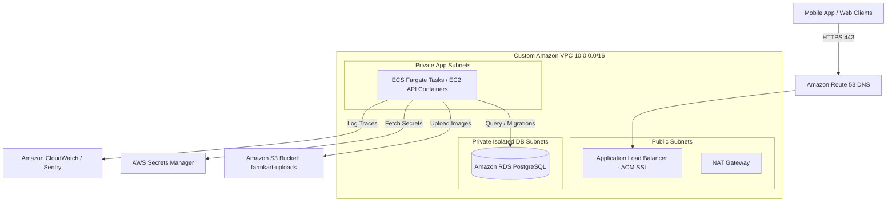

# FarmKart Production Deployment Guide (AWS)

This guide documents the architecture, infrastructure provisioning, and step-by-step deployment procedure for running **FarmKart API** on AWS in a secure, scalable production environment.

---

## 1. Architecture Overview



### Key Components
- **Networking**: VPC across 2+ Availability Zones with Public Subnets (ALB, NAT Gateways) and Private Subnets (ECS, RDS).
- **Compute**: AWS ECS Fargate (recommended) or EC2 instance with Nginx reverse proxy.
- **Database**: Amazon RDS PostgreSQL (Postgres 15+, Multi-AZ).
- **Object Storage**: Amazon S3 for media uploads (**strict S3-only in production, local-disk fallback disabled**).
- **SSL / TLS**: AWS Certificate Manager (ACM) attached to an Application Load Balancer (ALB).
- **Secrets Management**: AWS Secrets Manager for secure, encrypted credentials injection.

---

## 2. Amazon RDS PostgreSQL Setup

1. In the AWS RDS Console, create a new **PostgreSQL 15** database instance.
2. Select **Production** or **Dev/Test** template depending on workload:
   - DB Instance class: `db.t4g.small` or `db.t4g.medium` (Graviton-based, cost-effective).
   - Multi-AZ Deployment: Enabled for automated failover.
   - Storage: 20 GB to 100 GB gp3 with storage autoscaling enabled.
3. Network Configuration:
   - Place in **Private DB Subnets** (Not publicly accessible).
   - Security Group: Allow inbound TCP on port `5432` **only** from the ECS / EC2 security group (`sg-farmkart-api`).
4. Set Master Username (e.g., `farmkart_admin`) and a strong generated password.

---

## 3. Amazon S3 Storage Configuration

> [!IMPORTANT]
> In production (`ENV=production`), `farmkart-api` **strictly uploads to S3 and returns S3 URLs**. Local-disk fallback is disabled to prevent data loss across ephemeral containers.

### Create S3 Bucket
1. Create a bucket named `farmkart-uploads-<aws-account-id>` in your target region (e.g. `ap-south-1`).
2. Disable "Block all public access" only if serving files directly via S3 public read (or keep private and serve via Amazon CloudFront).
3. Enable **Default Encryption** (SSE-S3).

### Bucket Policy (for Public Media Read)
```json
{
  "Version": "2012-10-17",
  "Statement": [
    {
      "Sid": "PublicReadGetObject",
      "Effect": "Allow",
      "Principal": "*",
      "Action": "s3:GetObject",
      "Resource": "arn:aws:s3:::farmkart-uploads-<aws-account-id>/*"
    }
  ]
}
```

### CORS Configuration
Add the following CORS policy to allow the mobile app and web frontend to load uploaded media:
```json
[
  {
    "AllowedHeaders": ["*"],
    "AllowedMethods": ["GET", "HEAD"],
    "AllowedOrigins": ["*"],
    "ExposeHeaders": ["ETag"]
  }
]
```

---

## 4. AWS Secrets Manager Setup

Create a secret named `production/farmkart-api` in AWS Secrets Manager with the following key-value pairs:

| Secret Key | Description | Example / Recommended Format |
|---|---|---|
| `DB_HOST` | RDS PostgreSQL endpoint | `farmkart-db.xxxxxx.ap-south-1.rds.amazonaws.com` |
| `DB_PORT` | RDS PostgreSQL port | `5432` |
| `DB_USER` | RDS Master username | `farmkart_admin` |
| `DB_PASSWORD` | RDS Master password | Strong randomized password |
| `DB_NAME` | Database name | `farmkart` |
| `DB_SSLMODE` | PostgreSQL SSL mode | `require` |
| `JWT_SECRET` | 32+ char secret for JWT HMAC | Generate with `openssl rand -hex 32` |
| `ENV` | Environment identifier | `production` |
| `CORS_ORIGINS` | Allowed origins (comma-separated) | `https://farmkart.in,https://admin.farmkart.in` |
| `S3_BUCKET` | S3 bucket name | `farmkart-uploads-<account-id>` |
| `AWS_REGION` | AWS Region | `ap-south-1` |
| `SENTRY_DSN` | Sentry Error Reporting DSN | `https://xxxx@o0.ingest.sentry.io/00` |
| `MSG91_AUTH_KEY` | MSG91 SMS Auth Key | Production MSG91 API key |
| `MSG91_TEMPLATE_ID` | MSG91 OTP Template ID | MSG91 Approved Flow Template |
| `MSG91_SENDER_ID` | MSG91 Sender ID | Registered 6-char sender ID (e.g., `FRMKRT`) |
| `GOOGLE_CLIENT_IDS` | OAuth client IDs whose Google tokens are accepted (comma-separated): the Web client ID, plus the iOS one if used. Leave empty to disable Google sign-in. See section 11 | `1234-abc.apps.googleusercontent.com` |
| `SUPPORT_EMAIL` | Public contact for privacy and account-deletion requests, shown on `/account/delete`. Required in production | `support@example.com` |
| `S3_PUBLIC_BASE_URL` | Optional CDN/CloudFront base URL for uploaded images | `https://cdn.farmkart.in` |
| `FORWARDED_ALLOW_IPS` | IPs of the load balancer allowed to set `X-Forwarded-For` (needed for correct per-client rate limits) | VPC CIDR of the ALB, e.g. `10.0.0.0/16` |
| `GUNICORN_WORKERS` | Worker processes (default 2) | `2`–`4` per vCPU |
| `RUN_MIGRATIONS` | Run `alembic upgrade head` on container start (default `true`; set `false` if migrations run as a separate release step) | `true` |
| `ENABLE_DOCS` | Expose `/docs` & `/redoc` (default off in production) | `false` |
| `SENTRY_TRACES_SAMPLE_RATE` | Performance tracing sample rate | `0.1` |

> **Startup validation:** with `ENV=production` the API refuses to start unless `MSG91_AUTH_KEY`, `MSG91_TEMPLATE_ID` and `S3_BUCKET` are set, `CORS_ORIGINS` contains no `*`, and a remote database does not use `DB_SSLMODE=disable`. `ENV` defaults to `production`, so a missing value can never silently enable development behaviour.

---

## 5. IAM Roles & Permissions

Create an IAM Role for ECS Task Execution and Task Role (`farmkart-api-task-role`):

1. **ECS Task Execution Role (`ecsTaskExecutionRole`)**:
   - `AmazonECSTaskExecutionRolePolicy`
   - Inline policy granting `secretsmanager:GetSecretValue` on `arn:aws:secretsmanager:*:*:secret:production/farmkart-api*`.
2. **ECS Task Role (`farmkart-api-task-role`)**:
   - Inline policy granting S3 Put/Get permissions:
   ```json
   {
     "Version": "2012-10-17",
     "Statement": [
       {
         "Effect": "Allow",
         "Action": [
           "s3:PutObject",
           "s3:GetObject",
           "s3:DeleteObject"
         ],
         "Resource": "arn:aws:s3:::farmkart-uploads-<account-id>/*"
       }
     ]
   }
   ```

---

## 6. Deployment Option A: AWS ECS Fargate (Recommended)

### 1. Build and Push Container Image to ECR
Create an ECR repository named `farmkart-api`:
```bash
aws ecr create-repository --repository-name farmkart-api --region ap-south-1
```

Log in, build, tag, and push:
```bash
aws ecr get-login-password --region ap-south-1 | docker login --username AWS --password-stdin <account-id>.dkr.ecr.ap-south-1.amazonaws.com
docker build -t farmkart-api ./farmkart-api
docker tag farmkart-api:latest <account-id>.dkr.ecr.ap-south-1.amazonaws.com/farmkart-api:latest
docker push <account-id>.dkr.ecr.ap-south-1.amazonaws.com/farmkart-api:latest
```

### 2. ECS Task Definition (`task-def.json`)
The container runs as non-root user `appuser` (UID 1001), starts `start.sh`, executes `alembic upgrade head`, and launches Gunicorn with Uvicorn workers.

```json
{
  "family": "farmkart-api-task",
  "networkMode": "awsvpc",
  "requiresCompatibilities": ["FARGATE"],
  "cpu": "512",
  "memory": "1024",
  "executionRoleArn": "arn:aws:iam::<account-id>:role/ecsTaskExecutionRole",
  "taskRoleArn": "arn:aws:iam::<account-id>:role/farmkart-api-task-role",
  "containerDefinitions": [
    {
      "name": "farmkart-api",
      "image": "<account-id>.dkr.ecr.ap-south-1.amazonaws.com/farmkart-api:latest",
      "portMappings": [
        {
          "containerPort": 8000,
          "hostPort": 8000,
          "protocol": "tcp"
        }
      ],
      "secrets": [
        { "name": "DB_HOST", "valueFrom": "arn:aws:secretsmanager:ap-south-1:<account-id>:secret:production/farmkart-api:DB_HOST::" },
        { "name": "DB_PASSWORD", "valueFrom": "arn:aws:secretsmanager:ap-south-1:<account-id>:secret:production/farmkart-api:DB_PASSWORD::" },
        { "name": "DB_USER", "valueFrom": "arn:aws:secretsmanager:ap-south-1:<account-id>:secret:production/farmkart-api:DB_USER::" },
        { "name": "DB_NAME", "valueFrom": "arn:aws:secretsmanager:ap-south-1:<account-id>:secret:production/farmkart-api:DB_NAME::" },
        { "name": "JWT_SECRET", "valueFrom": "arn:aws:secretsmanager:ap-south-1:<account-id>:secret:production/farmkart-api:JWT_SECRET::" },
        { "name": "MSG91_AUTH_KEY", "valueFrom": "arn:aws:secretsmanager:ap-south-1:<account-id>:secret:production/farmkart-api:MSG91_AUTH_KEY::" },
        { "name": "SENTRY_DSN", "valueFrom": "arn:aws:secretsmanager:ap-south-1:<account-id>:secret:production/farmkart-api:SENTRY_DSN::" }
      ],
      "environment": [
        { "name": "ENV", "value": "production" },
        { "name": "PORT", "value": "8000" },
        { "name": "GUNICORN_WORKERS", "value": "4" },
        { "name": "AWS_REGION", "value": "ap-south-1" },
        { "name": "S3_BUCKET", "value": "farmkart-uploads-<account-id>" }
      ],
      "logConfiguration": {
        "logDriver": "awslogs",
        "options": {
          "awslogs-group": "/ecs/farmkart-api",
          "awslogs-region": "ap-south-1",
          "awslogs-stream-prefix": "api"
        }
      },
      "healthCheck": {
        "command": ["CMD-SHELL", "curl -f http://localhost:8000/health || exit 1"],
        "interval": 30,
        "timeout": 5,
        "retries": 3,
        "startPeriod": 15
      }
    }
  ]
}
```

### 3. Create ECS Service
1. Create an ECS Cluster `farmkart-production`.
2. Create a Fargate Service pointing to the Task Definition:
   - Desired Tasks: 2+ (for High Availability).
   - Subnets: Private App Subnets.
   - Attach to Application Load Balancer Target Group.

---

## 7. Deployment Option B: EC2 + Nginx Reverse Proxy

For a single-instance or auto-scaling EC2 deployment:

### Nginx Configuration (`/etc/nginx/sites-available/farmkart.conf`)
```nginx
upstream farmkart_api {
    server 127.0.0.1:8000 fail_timeout=0;
}

server {
    listen 80;
    server_name api.farmkart.in;
    return 301 https://$host$request_uri;
}

server {
    listen 443 ssl http2;
    server_name api.farmkart.in;

    ssl_certificate /etc/letsencrypt/live/api.farmkart.in/fullchain.pem;
    ssl_certificate_key /etc/letsencrypt/live/api.farmkart.in/privkey.pem;
    ssl_protocols TLSv1.2 TLSv1.3;
    ssl_ciphers HIGH:!aNULL:!MD5;

    client_max_body_size 6M;

    location / {
        proxy_pass http://farmkart_api;
        proxy_set_header Host $host;
        proxy_set_header X-Real-IP $remote_addr;
        proxy_set_header X-Forwarded-For $proxy_add_x_forwarded_for;
        proxy_set_header X-Forwarded-Proto $scheme;
        proxy_read_timeout 60s;
        proxy_connect_timeout 60s;
    }

    location /health {
        proxy_pass http://farmkart_api/health;
        proxy_set_header Host $host;
        access_log off;
    }
}
```

### Systemd Service (`/etc/systemd/system/farmkart-api.service`)
```ini
[Unit]
Description=FarmKart FastAPI Application
After=network.target

[Service]
User=appuser
Group=appgroup
WorkingDirectory=/opt/farmkart/farmkart-api
EnvironmentFile=/opt/farmkart/farmkart-api/.env
ExecStartPre=/opt/farmkart/farmkart-api/.venv/bin/alembic upgrade head
ExecStart=/opt/farmkart/farmkart-api/.venv/bin/gunicorn -k uvicorn.workers.UvicornWorker -w 4 -b 127.0.0.1:8000 app.main:app
Restart=always
RestartSec=5

[Install]
WantedBy=multi-user.target
```

---

## 8. HTTPS via ACM and Application Load Balancer (ALB)

1. **Request SSL Certificate**:
   - Go to **AWS Certificate Manager (ACM)** in region `ap-south-1`.
   - Request a public certificate for `api.farmkart.in` (and optionally `*.farmkart.in`).
   - Validate domain ownership via DNS CNAME record in Route 53.
2. **Configure ALB Target Group**:
   - Target type: `IP` (for ECS Fargate) or `Instance` (for EC2).
   - Protocol: `HTTP` on port `8000`.
   - Health check path: `/health`.
   - Healthy threshold: 2, Unhealthy threshold: 3, Timeout: 5s, Interval: 15s.
   - Success codes: `200`.
3. **Configure ALB Listeners**:
   - **HTTP (80)**: Redirect to HTTPS (Port 443, 301 Permanent).
   - **HTTPS (443)**: Default action forwards to Target Group `farmkart-api-tg`.
   - Attach the ACM SSL Certificate.

---

## 9. Automated CI/CD via GitHub Actions

Workflow file: [.github/workflows/deploy.yml](file:///.github/workflows/deploy.yml)

### Required GitHub Repository Secrets:
- `AWS_ACCESS_KEY_ID`: IAM user with ECR push permissions.
- `AWS_SECRET_ACCESS_KEY`: IAM secret key.
- `AWS_REGION`: e.g. `ap-south-1`.
- `ECR_REPOSITORY`: e.g. `farmkart-api`.

On every push to `main`, GitHub Actions:
1. Runs the test suite (`.github/workflows/test.yml`).
2. Logs in to AWS ECR.
3. Builds the multi-stage Docker image with layer caching.
4. Pushes tags `:latest` and `:<git-sha>`.
5. (Optional) Triggers ECS deployment using `aws ecs update-service --force-new-deployment`.

---

## 10. Local Development with Docker Compose

For local full-stack development with a clean PostgreSQL container:

```bash
cd farmkart-api
docker compose up --build
```

- PostgreSQL will start and create database `farmkart`.
- The API service waits for Postgres health check, executes `alembic upgrade head`, and starts Gunicorn on `http://localhost:8000`.
- Health check available at `http://localhost:8000/health`.
- Interactive Swagger docs available at `http://localhost:8000/docs`.


---

## 11. Mobile Release Configuration (EAS)

Production values live in the EAS **production** environment, not in `eas.json`.
`app.config.ts` refuses to build a production binary unless `EXPO_PUBLIC_API_URL` is a real HTTPS URL.

```bash
eas env:create --environment production --visibility plaintext --name EXPO_PUBLIC_API_URL --value https://api.<your-domain>
eas env:create --environment production --visibility plaintext --name EXPO_PUBLIC_GOOGLE_WEB_CLIENT_ID --value <web-client-id>
# iOS only:
eas env:create --environment production --visibility plaintext --name EXPO_PUBLIC_GOOGLE_IOS_CLIENT_ID --value <ios-client-id>
```

Add the same variables to the `preview` environment if preview builds should sign in with Google.

### Google Sign-In

The app uses native Google Sign-In (`@react-native-google-signin/google-signin`). It does **not**
work in Expo Go; use a development build (`eas build --profile development`).

1. **Google Cloud Console → APIs & Services → OAuth consent screen**: create the app as *External*.
   Use scopes `openid`, `email`, `profile`. Set the support email and privacy policy URL, add test
   users while it is in *Testing*, then *Publish* it.
2. **Credentials → Create OAuth client ID → Web application** (e.g. "FarmKart Web").
   This ID goes in `EXPO_PUBLIC_GOOGLE_WEB_CLIENT_ID` (app) and `GOOGLE_CLIENT_IDS` (API).
   Sign-in tokens are issued for this client on every platform. For the web build, add its origin
   under *Authorized JavaScript origins* and *Authorized redirect URIs*.
3. **Create OAuth client ID → Android**, package `com.vignesh.farmkart`, once **per signing key**:
   - EAS upload/build key: `eas credentials -p android` → *Keystore* → copy the **SHA-1**.
   - Google Play App Signing key (for Play Store installs): Play Console → *Test and release →
     App integrity → App signing* → copy the **SHA-1**.
   The Android client ID is not put anywhere in code; Google matches it by package + SHA-1.
   A missing or wrong SHA-1 gives `DEVELOPER_ERROR` ("not set up for this app build yet" in the app).
4. **iOS (optional) → Create OAuth client ID → iOS**, bundle ID `com.vignesh.farmkart`. Set
   `EXPO_PUBLIC_GOOGLE_IOS_CLIENT_ID` and append the ID to `GOOGLE_CLIENT_IDS`.
5. Rebuild the app (native config changed) and redeploy the API with the new `GOOGLE_CLIENT_IDS`.

### Google Play: data safety and account deletion

- **Delete account URL**: `https://api.<your-domain>/account/delete` (public page served by the API).
- **Privacy policy URL**: needs a public web page. The in-app policy is `src/app/privacy.tsx`; host
  the same text (e.g. GitHub Pages) before submitting.
- Account deletion (`DELETE /auth/me`) refuses while an order is confirmed / packed / shipped /
  out for delivery or a UPI payment is awaiting verification, auto-cancels orders not yet accepted,
  erases profile data and the user's avatar, removes the buyer's address from their past orders,
  and archives a seller's listings. Order amounts and items are kept for accounting.

